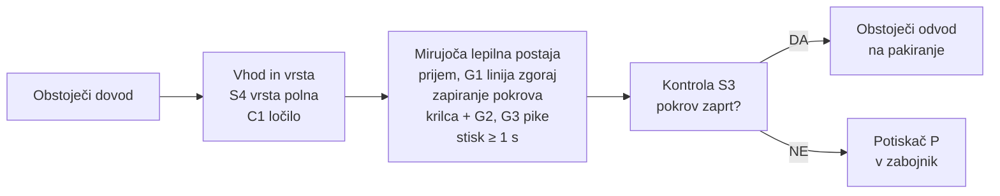
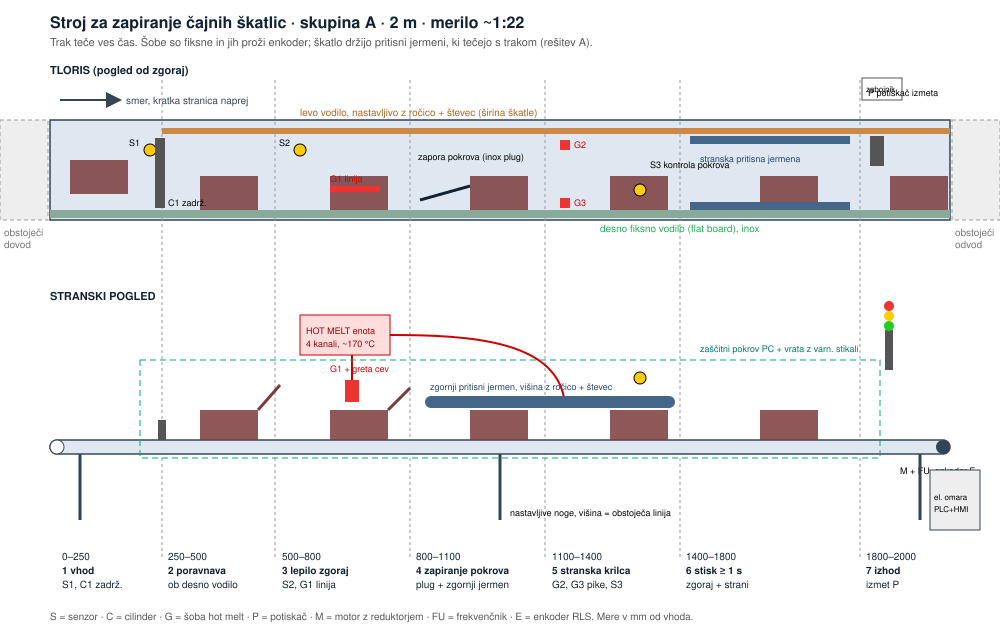

# Avtomatsko zapiranje čajnih škatlic

**Skupina A · LUI Scaleup Journey 2026 · odgovor na povpraševanje LUI-RFQ-01**

Predstavitev: 8 minut + 4 minute vprašanj. Podrobnosti so v [`kalkulacija_bom.md`](kalkulacija_bom.md).

---

## 1. Kaj smo razumeli (0:30)

| Zahteva | Vrednost |
|---|---|
| Kapaciteta | 7 do 10 škatel/min, pozneje do 17/min |
| Prostor v liniji | največ 2 m med obstoječim dovodom in odvodom |
| Vhod | škatle pridejo naključno, vedno s kratko stranico naprej, desno ob vodilu |
| Formati | dolžina enaka, širina in višina različni |
| Menjava formata | v 3 minutah, en operater |
| Lepljenje | hot melt: linija po celi dolžini zgoraj, pike na stranskih krilcih |
| Kontrola | zaznati odprt pokrov in slabo škatlo izločiti |

## 2. Blokovna shema (1:00)

## 3. Naša rešitev (2:00)

**Trak teče ves čas, lepilna postaja miruje.**

- Trak je drsen: škatle, ki čakajo, stojijo v vrsti in trak drsi pod njimi. Zato **ni lopatk** in vrsta je hkrati blažilnik za zastoje na dovodu.
- **Ena lepilna postaja z eno hot melt enoto in 3 šobami.** Postaja prime škatlo, jo drži na mestu in naredi vse naenkrat:
  1. G1 nanese lepilo na zgornji pas (ena šoba čez celo dolžino, ker je dolžina pri vseh formatih enaka);
  2. zasučni cilinder zapre pokrov in ga stisne;
  3. stranska cilindra zapreta krilca, G2 in G3 naneseta pike;
  4. stisk vsaj 1 s, nato postaja spusti škatlo in trak jo odpelje.
- Nič se ne vozi ob traku: ni linearne osi, ni servo pogona, lepilne cevi so pri miru.

### Skica sistema

### 3D koncept (Luka)

*Konceptna slika: razporeditev in nepodane mere so ilustrativne. Vhodni trak (1), lepilne šobe (2), zapiranje pokrova (3), pritisni del (4), izhodni trak (5), izmet (6).*

## 4. Izračun (vključeno v 3)

| | |
|---|---|
| Čas na škatlo pri 10/min | **6 s** |
| Čas cikla postaje | **3,4 s** (prijem 0,5 · lepilo 0,4 · pokrov 0,5 · krilca 0,5 · stisk 1,0 · spust 0,5) |
| Največja kapaciteta | **~17 škatel/min**, torej že faza 2 brez predelave |
| Hitrost traku | **6 do 20 m/min**, usklajena z obstoječo linijo (frekvenčnik) |

## 5. Izbira tehnologij (1:30)

| Sklop | Izbira | Zakaj |
|---|---|---|
| Krmiljenje | PLC Siemens S7-1200 + zaslon 4" z recepti formatov | standard v industriji, servis povsod |
| Pogon traku | mali motor z reduktorjem 0,37 kW + frekvenčnik + enkoder RLS | škatle so lahke, hitrost nastavljiva |
| Gibi na postaji | pnevmatski cilindri (prijemalo, pokrov, krilca, ločilo, izmet) | poceni, hitro, dovolj pri 10 do 17/min |
| Zrak | lasten rezervoar, tlačno stikalo, alarm pod 5 bar | zanesljivo, tudi ko kompresor zamuja |
| Lepilo | ena hot melt enota, 3 šobe, proženje iz PLC | nanos na mirujočo škatlo je natančen |
| Kontrola | fotosenzor nad pokrovom + potiskač izmeta | jasno DA/NE za vsako škatlo, linija se ne ustavi |
| Menjava formata | levo vodilo z ročico in števcem, hod prijemala in šob v receptu | en operater, 3 minute |

**Alternativi, ki smo ju pretehtali:**
- **pritisni jermeni ob traku in fiksne šobe** (zapiralnik kartonov): deluje, a več gibljivih delov in tri nastavitve pri menjavi formata, dražje okoli 16 k€;
- **robotska roka**: zelo prilagodljivo, a dražje za 30 do 45 k€, počasneje in zahtevnejša varnost.

## 6. Varnost, higiena, tveganja (0:45)

- **HACCP:** stroj nima stika z živilom (čaj je v vrečkah in škatli), certifikacija ni potrebna. Vseeno higienska izvedba: inox, maziva H1, lepilo za posredni stik z živili.
- **Varnost pri delu:** zaprta postaja, vrata z varnostnimi stikali, gobasta izklopa, varnostni rele (PLd). Ob odprtju se ustavi trak, odzrači pnevmatika in zaprejo šobe. Odprtini za škatle sta premajhni za roko, kot opcija svetlobna zavesa.
- **Vroče lepilo (~170 °C):** zaščita, oznake, varen način za čiščenje šobe.
- **Največja tveganja:** oprijem lepila na lakiranem kartonu (test na vzorcih pred konstrukcijo), praskanje škatel, ko čakajo na traku (drsni trak), ena postaja je ena točka odpovedi (rezervna šoba na zalogi).

## 7. Cena in povračilo (1:00)

| Sklop | Znesek |
|---|---|
| Planiranje (konstrukcija 50 h, ocena tveganja in CE 20 h) | 3.850 € |
| Mehanika (material + izdelava pri kooperantu v Srbiji) | 6.230 € |
| Elektro (senzorji, pnevmatika, programiranje) | 6.815 € |
| Elektro omara (PLC, zaslon, varnost) | 4.000 € |
| Stroj za lepljenje (1 enota, 3 šobe) | 6.000 € |
| Montaža | 800 € |
| Zagon (preizkus pri nas + zagon pri stranki) | 1.760 € |
| Logistika in kontrola kakovosti pri kooperantu | 1.600 € |
| **Lastna cena** | **31.055 €** |
| Rezerva 10 % | 3.105 € |
| Dodatek 30 % | 10.250 € |
| **Prodajna cena** | **≈ 44.400 € brez DDV** |

Planiranje je 9 % cene (postaja je preprosta, večino znanja že imamo), elektro z omaro 24 %.

**Za stranko:** stroj nadomesti ročno zapiranje, kar je en človek ves čas na izmeno (≈ 55.000 €/leto). Po odbitku nadzora in obratovalnih stroškov ostane okoli 37.000 €/leto na izmeno.

| | 1 izmena | 2 izmeni |
|---|---|---|
| **Povračilo** | **~1,2 leta** | **~0,6 leta** |

## 8. Faze, merila in kaj rabimo od vas (0:30)

**Faze:** test lepljenja na vzorcih vseh formatov (2 tedna) → konstrukcija (3 tedne) → izdelava in programiranje (5 tednov) → preizkus pri nas, 500 škatel na format → montaža v linijo in zagon (2 dni) → spremljanje prvi mesec.

**Merila uspešnosti:** ≥ 99,5 % pravilno zaprtih · 10 škatel/min 8 ur brez zastoja po naši krivdi · menjava formata ≤ 3 min · pokrov se pri odpiranju trga po kartonu, ne po lepilu.

**Kaj rabimo od naročnika:**
1. vzorce vseh formatov in mere zavihkov;
2. kje točno je pas za lepilo in katero lepilo smete uporabiti;
3. hitrost dovodnega traku in signale linije (start/stop, zastoj);
4. zrak in elektriko na mestu, prostor okoli 2 m;
5. kaj je za vas »pravilno zaprto« in kam z izločenimi škatlami.

---

## Pričakovana vprašanja

- **Zakaj postaja miruje?** Lepilo gre na škatlo, ki se ne premika, zato je nanos natančen. Ni gibljivih cevi in ni servo osi, zato je ceneje in zanesljivo.
- **Kaj, če škatle pridejo v gruči?** Postavijo se v vrsto, trak drsi pod njimi. Ko je vrsta polna, S4 ustavi dovod.
- **Kako v 3 minutah?** Ročno se nastavi samo levo vodilo (ročica s števcem), ostalo izbereš na zaslonu.
- **Zakaj ne izpih za izmet?** Izpih je odvisen od zraka. Potiskač je zanesljivejši.
- **Kaj, če je budget nižji?** Brez senzorja pokrova in izmeta (izločanje ročno na pakiranju) in z ročnim nastavljanjem prijemala.
- **Kako do 17/min?** Cikel je 3,4 s, kar je že danes dovolj.
