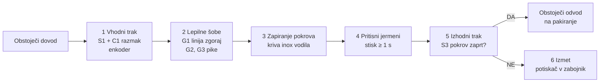

# Avtomatsko zapiranje čajnih škatlic

**Skupina A · LUI Scaleup Journey 2026 · odgovor na povpraševanje LUI-RFQ-01**

Predstavitev: 8 minut + 4 minute vprašanj. Podrobnosti so v [`kalkulacija_bom.md`](kalkulacija_bom.md).

---

## 1. Kaj smo razumeli (0:30)

| Zahteva | Vrednost |
|---|---|
| Kapaciteta | 7 do 10 škatel/min, pozneje do 17/min |
| Prostor v liniji | največ 2 m med obstoječim dovodom in odvodom |
| Vhod | škatle pridejo naključno, vedno s kratko stranico naprej, desno ob vodilu |
| Formati | dolžina enaka, širina in višina različni |
| Menjava formata | v 3 minutah, en operater |
| Lepljenje | hot melt: linija po celi dolžini zgoraj, pike na stranskih krilcih |
| Kontrola | zaznati odprt pokrov in slabo škatlo izločiti |

## 2. Blokovna shema (1:00)

## 3. Naša rešitev (2:00)

**Škatle se ves čas peljejo, nič se ne ustavlja.**

1. **Vhodni trak:** S1 zazna škatlo, zadrževalni cilinder C1 jih spušča na enak razmak (okoli 30 cm). Enkoder RLS na traku meri premik, zato točno vemo, kje je vsaka škatla.
2. **Lepilne šobe:** fiksne, z eno hot melt enoto pod trakom. S2 zazna začetek in konec škatle, enkoder sproži šobe: **G1 nariše linijo po celi dolžini zgoraj, G2 in G3 pike na stranski krilci.**
3. **Zapiranje pokrova:** kriva inox vodila pokrov med vožnjo zaprejo, brez motorja in brez cilindra.
4. **Pritisni jermeni:** tečejo z isto hitrostjo kot trak in držijo pokrov **vsaj 1 s**, da se lepilo prime. Dolžina 600 mm, višina se nastavi z ročnim kolesom.
5. **Izhodni trak:** S3 preveri, ali je pokrov zaprt.
6. **Izmet:** slabo škatlo potiskač porine v zabojnik, linija se ne ustavi.

### Shema sistema

### 3D koncept (Luka)

*Konceptna slika: razporeditev in nepodane mere so ilustrativne.*

## 4. Izračun (vključeno v 3)

| | |
|---|---|
| Razmak med škatlami | ~30 cm (C1) |
| Hitrost traku pri 10 škatlah/min | 10 × 0,3 m = **3 m/min** |
| Hitrost traku pri 17 škatlah/min | **5 m/min** |
| Območje frekvenčnika | **2 do 20 m/min**, usklajeno z obstoječo linijo |
| Stisk pod jermenom 600 mm | 12 s pri 3 m/min, **1,8 s pri 20 m/min**, torej vedno ≥ 1 s |
| Čas na škatlo pri 10/min | 6 s; stroj ne omejuje takta, ker se nič ne ustavlja |

## 5. Izbira tehnologij (1:30)

| Sklop | Izbira | Zakaj |
|---|---|---|
| Krmiljenje | PLC Siemens S7-1200 + zaslon z recepti formatov | standard v industriji, servis povsod |
| Pogon | mali motorji z reduktorjem + frekvenčnik + enkoder RLS | škatle so lahke, hitrost usklajena z linijo |
| Lepilo | ena hot melt enota, 3 fiksne šobe, proženje po enkoderju | brez gibljivih cevi, točen začetek in konec nanosa |
| Zapiranje pokrova | kriva inox vodila | brez pogona, nič se ne pokvari |
| Stisk | pritisni jermeni, gnani z glavnega traku | ista hitrost kot škatla, ni drsenja |
| Pnevmatika | samo C1 in potiskač izmeta, lasten rezervoar, tlačno stikalo | malo zraka, zanesljivo |
| Kontrola | fotosenzor nad pokrovom + potiskač | jasno DA/NE za vsako škatlo |
| Menjava formata | levo vodilo in višina jermenov z ročnima kolesoma in števcema, šobe v receptu | en operater, 3 minute |

**Alternative, ki smo jih pretehtali:**
- **mirujoča lepilna postaja** (prime škatlo, ostale čakajo na drsnem traku): ceneje za ~1.900 €, a škatle drgnejo po traku in vsaka gre skozi ustavitev;
- **leteča lepilna glava na linearni osi**: natančna, a servo os in gibljive grete cevi;
- **robotska roka**: dražje za 30 do 45 k€, počasneje, zahtevnejša varnost.

## 6. Varnost, higiena, tveganja (0:45)

- **HACCP:** stroj nima stika z živilom (čaj je v vrečkah in škatli), certifikacija ni potrebna. Vseeno higienska izvedba: inox, maziva H1, lepilo za posredni stik z živili.
- **Varnost pri delu:** ohišje iz polikarbonata, vrata z varnostnimi stikali, gobasta izklopa, varnostni rele (PLd). Ob odprtju se ustavijo trakovi, odzrači pnevmatika in zaprejo šobe. Svetlobni stolpec kaže stanje.
- **Vroče lepilo (~170 °C):** enota pod trakom za zaščito, oznake, varen način za čiščenje šob.
- **Največja tveganja:** oprijem lepila na lakiranem kartonu (test na vzorcih pred konstrukcijo), stranska krilca odskočijo (vodila pred šobami), zastoj za strojem (senzor nabiranja ustavi C1).

## 7. Cena in povračilo (1:00)

| Sklop | Znesek |
|---|---|
| Planiranje (konstrukcija 50 h, ocena tveganja in CE 20 h) | 3.850 € |
| Mehanika (trakovi, vodila, pritisni jermeni, ohišje; izdelava pri kooperantu v Srbiji) | 8.460 € |
| Elektro (motorji, senzorji, pnevmatika, programiranje) | 5.925 € |
| Elektro omara (PLC, zaslon, varnost) | 4.000 € |
| Stroj za lepljenje (1 enota, 3 šobe) | 6.000 € |
| Montaža | 800 € |
| Zagon (preizkus pri nas + zagon pri stranki) | 1.760 € |
| Logistika in kontrola kakovosti pri kooperantu | 1.600 € |
| **Lastna cena** | **32.395 €** |
| Rezerva 10 % | 3.240 € |
| Dodatek 30 % | 10.690 € |
| **Prodajna cena** | **≈ 46.300 € brez DDV** |

**Za stranko:** stroj nadomesti ročno zapiranje, kar je en človek ves čas na izmeno (≈ 55.000 €/leto). Po odbitku nadzora in obratovalnih stroškov ostane okoli 37.000 €/leto na izmeno.

| | 1 izmena | 2 izmeni |
|---|---|---|
| **Povračilo** | **~1,2 leta** | **~0,6 leta** |

## 8. Faze, merila in kaj rabimo od vas (0:30)

**Faze:** test lepljenja na vzorcih vseh formatov (2 tedna) → konstrukcija (3 tedne) → izdelava in programiranje (5 tednov) → preizkus pri nas, 500 škatel na format → montaža v linijo in zagon (2 dni) → spremljanje prvi mesec.

**Merila uspešnosti:** ≥ 99,5 % pravilno zaprtih · 10 škatel/min 8 ur brez zastoja po naši krivdi · menjava formata ≤ 3 min · pokrov se pri odpiranju trga po kartonu, ne po lepilu.

**Kaj rabimo od naročnika:**
1. vzorce vseh formatov in mere zavihkov;
2. kje točno je pas za lepilo in katero lepilo smete uporabiti;
3. hitrost dovodnega traku in signale linije (start/stop, zastoj);
4. zrak in elektriko na mestu, prostor okoli 2 m;
5. kaj je za vas »pravilno zaprto« in kam z izločenimi škatlami.

---

## Pričakovana vprašanja

- **Zakaj se škatle ne ustavijo?** Ni zastojev, ni drgnjenja po traku, takt določa samo hitrost traku. Šobe proži enkoder, zato nanos kljub vožnji pade točno na pas.
- **Kaj, če škatle pridejo v gruči?** C1 jih spušča eno po eno na enak razmak. Ko se pred C1 nabere vrsta, se ustavi dovod.
- **Kako v 3 minutah?** Dve ročni kolesi s števcem (širina, višina jermenov), ostalo izbereš na zaslonu.
- **Zakaj ne izpih za izmet?** Izpih je odvisen od zraka. Potiskač je zanesljivejši.
- **Kaj, če je budget nižji?** Brez senzorja pokrova in izmeta (izločanje ročno na pakiranju) ali mirujoča postaja (~1.900 € manj).
- **Kako do 17/min?** Trak samo pospešimo na 5 m/min, stroj je že narejen za to.
