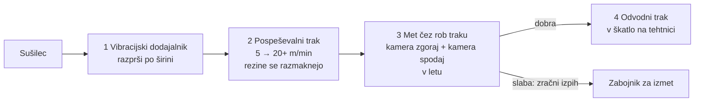

# Naloga 2: avtomatska kontrola jabolčnega čipsa (LUI-RFQ-02)

Osnova: povpraševanje (PDF, stran 2) in ustna navodila naročnika 31. 10. ob 11:28. Enako kot pri prvi nalogi: **konstrukcija in cena**.

## Kaj je povedal naročnik

| Zahteva | Vrednost |
|---|---|
| Od kod pridejo | iz sušilca, krhlji padejo na trak v razsutem toku |
| Kaj naredimo | razporedimo, pregledamo **zgoraj in spodaj** s kamerami, izločimo slabe |
| Kaj je slabo | črne pike (plesen), druge napake na rezini |
| Dobri | v **eno škatlo na koncu, pod škatlo je tehtnica** (škatla se polni po masi, ne po kosih) |
| Slabi | v drug zabojnik (ne na tla) |
| Dolžina | **največ 4 m** |
| Vhod | modri trak naročnika odstranimo, **naš trak se priklopi direktno pod sušilec** |
| Hitrost | dovod **okoli 5 m/min**; požreti moramo vse, kar pride (količina kot na videu) |
| Pogoj | **rezine se ne smejo prekrivati**, sicer jih kamera ne vidi |
| Kameri | **fokus 500 mm od traku**; **kameri že ima stranka**, nista v naši ceni |
| Iz PDF | nežno ravnanje, stik z živili, higiensko čiščenje, čim manj lomljenja, sledljivost, enostavne nastavitve in obravnava napak |

> **Posodobljeno:** glavni koncept je **vibracijska miza + dva traka z obračanjem rezine in dvojnim izmetom**; vision (kameri, luči, obdelava, programiranje) dobavi stranka. Glej `PREDSTAVITEV.md`, `kalkulacija_bom.md` in `skica_cips_obracanje.svg`. Spodnji predlog je prvi osnutek.

## Predlog poteka (4 m)

| Odsek | Dolžina | Kaj |
|---|---|---|
| 1 Vibracijski dodajalnik | ~0,8 m | prevzame kup iz sušilca, razprši rezine po širini |
| 2 Pospeševalni trak | ~1,6 m | teče 4 do 5-krat hitreje od dovoda, zato se rezine razmaknejo in ne prekrivajo |
| 3 Pregled in izmet | ~0,4 m | rezine letijo čez konec traku; dve linijski kameri (zgoraj, spodaj) ju vidita v letu z obeh strani, šobe za zrak izpihnejo slabe |
| 4 Odvod v škatlo | ~1,2 m | dobre na kratek trak, ki jih strese v škatlo na tehtnici; ob polni masi menjava škatle |

## Kameri: 500 mm fokusa

- zgornja kamera visi **500 mm nad** linijo leta, spodnja je **500 mm pod** njo, obe gledata pravokotno na rezine, vsaka s svojo lučjo (linijska LED, ki ne bliska);
- zato rabimo pod koncem pospeševalnega traku **vsaj ~600 mm prostora** (kamera + ohišje), trak mora biti **na višini ~1.000 mm ali več**, odvodni trak in žleb za izmet pa nižje;
- spodnja kamera gleda navzgor, zato jo zaščitimo s steklom in zračno zaveso (drobtine padajo nanjo), steklo se čisti brez orodja;
- pri 500 mm in tipičnem objektivu ena kamera pokrije **širino traku okoli 400 do 600 mm**; če je trak širši, dve kameri na stran.

## Izmet: kako

**Zračni izpih v letu (tako delajo optični sortirniki za suho sadje):**
- rezine zletijo z roba pospeševalnega traku v loku; točno tam sta obe kameri, ena od zgoraj in ena od spodaj, zato vidimo **obe strani brez obračanja rezine**;
- čez celo širino je **letev s hitrimi ventili** (npr. 32 do 64 šob, vsaka pokriva 10 do 20 mm širine, odziv 1 do 3 ms);
- računalnik ve, kje je slaba rezina (položaj iz slike + enkoder), in odpre samo šobo na njeni širini za nekaj milisekund;
- slaba rezina dobi kratek sunek zraka in pade v **ločen žleb za izmet**, dobre letijo naprej na odvodni trak;
- rezina tehta 1 do 3 g, zato je izpih idealen: ne dotakne se je nič, ni lomljenja, ni gibljivih delov v stiku z živilom.

**Kar se je naročnik naučil pri škatlah (izpih je odpovedal), tukaj rešimo:** lasten zračni rezervoar ob letvi, tlačno stikalo z alarmom, filter za živilski zrak (brez olja), ob padcu tlaka se dovod ustavi.

**Alternativi:**
- **mehanska loputa** pod koncem traku: deluje samo, če so rezine daleč narazen, sicer vrže ven tudi dobre; počasnejša;
- **robot z vakuumskim prijemalom (delta)**: pobere slabe s traka, nežno, a drago in pri večji gostoti ne dohaja.

## Kaj še odpreti z naročnikom
1. koliko rezin na minuto oziroma kg/h (iz videa ocenimo, potem potrdimo);
2. velikost in debelina rezin, kako so krhke in lepljive;
3. katere napake točno (črne pike, temne rezine, lomljene, tujki) in koliko lažnega izmeta je sprejemljivo;
4. masa škatle, ki jo polnimo, in kako se škatla menja;
5. prostor pod sušilcem (višina za vibracijski dodajalnik in met).

## Naslednji koraki
- [ ] iz videa oceniti, koliko rezin na minuto pride
- [x] skica: `skica_cips_obracanje.svg` (glavni), `skica_cips.svg` (alternativa)
- [x] kosovnica in kalkulacija: `kalkulacija_bom.md` (~33.600 €, vision dobavi stranka)
- [x] povračilo za stranko (v kalkulaciji; potrditi, koliko ljudi danes pregleduje)
- [x] varnost, HACCP (tu je **neposreden stik z živilom**, zato inox, živilski trakovi, čiščenje), tveganja
