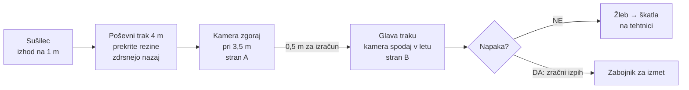
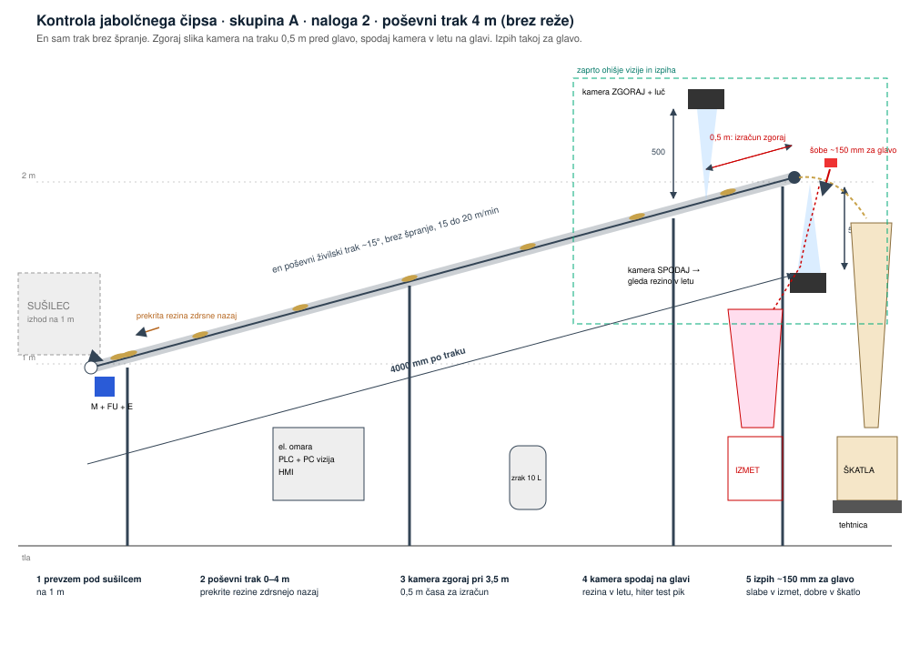
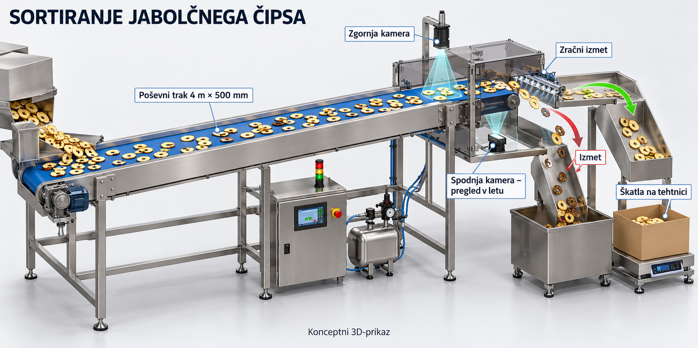

# Avtomatska kontrola jabolčnega čipsa

**Skupina A · LUI Scaleup Journey 2026 · odgovor na povpraševanje LUI-RFQ-02**

Predstavitev: 8 minut + 4 minute vprašanj. Podrobnosti so v [`kalkulacija_bom.md`](kalkulacija_bom.md).

---

## 1. Kaj smo razumeli (0:30)

| Zahteva | Vrednost |
|---|---|
| Vhod | rezine pridejo iz sušilca v razsutem toku, na višini 1 m |
| Dovod | okoli 5 m/min, pobrati moramo vse, kar pride |
| Prostor | naš trak največ 4 m, nadomesti obstoječi modri trak |
| Pregled | **obe strani** rezine, napake so črne pike (plesen) |
| Pogoj | rezine se ne smejo prekrivati |
| Izhod | dobre v škatlo na tehtnici, slabe v ločen zabojnik |
| Kameri | **ima že stranka**, fokus 500 mm |
| Higiena | stik z živili, nežno, čim manj lomljenja |

## 2. Blokovna shema (1:00)

## 3. Naša rešitev (2:00)

1. **Poševni trak 4 m × 500 mm**, en kos brez špranje, ~15° navzgor od 1 m do ~2 m. Teče 15 do 20 m/min, torej 3 do 4-krat hitreje od dovoda: rezine se razmaknejo, prekrite pa na klancu zdrsnejo nazaj.
2. **Kamera zgoraj** nad trakom pri 3,5 m vidi zgornjo stran. Do glave traku je **0,5 m**, kar je pri 20 m/min **1,5 s za izračun**.
3. **Kamera spodaj** pod glavo traku vidi spodnjo stran, ko rezina zleti čez rob. Tu je časa malo, zato samo hiter test temnih pik.
4. **Zračni izpih** takoj za glavo: letev 32 hitrih ventilov čez širino, vsak pokriva ~15 mm. Slaba rezina dobi kratek sunek in pade v izmet. Rezine se nič ne dotakne, ni lomljenja.
5. Dobre rezine letijo po žlebu v **škatlo na tehtnici**, ki javi, ko je polna.

### Skica

### 3D koncept (Luka)

## 4. Simulacija (Luka) (1:00)

> **Sem pride Lukov simulator** (povezava, posnetek ali sličica). Kaj naj pokaže:
> - rezine prihajajo iz sušilca s 5 m/min in se na poševnem traku razmaknejo;
> - koliko se jih prekriva pred kamero (cilj: skoraj nič);
> - kamera označi slabe, izpih jih vrže v izmet, dobre gredo v škatlo;
> - števec: rezin na minuto, izločenih, polnjenje škatle.
>
> Ob simulaciji povejte izračun spodaj.

| Izračun | |
|---|---|
| Hitrost dovoda | ~5 m/min |
| Hitrost našega traku | 15 do 20 m/min (3 do 4-krat hitreje → razmak med rezinami) |
| Čas od kamere zgoraj do izpiha | 0,5 m / 20 m/min = **1,5 s** |
| Širina enega ventila | ~15 mm (32 ventilov na 500 mm) |
| Odziv ventila | 1 do 3 ms |

## 5. Izbira tehnologij (1:00)

| Sklop | Izbira | Zakaj |
|---|---|---|
| Razporejanje | poševni trak, hitrejši od dovoda | brez vibratorja, prekrite rezine same zdrsnejo nazaj |
| Pregled | 2 kameri stranke + naši LED luči + PC za obdelavo slike | obe strani, enakomerna svetloba |
| Izmet | zračni izpih, letev 32 ventilov | rezine tehtajo 1 do 3 g, ničesar se ne dotakne |
| Zrak | lasten rezervoar, filter brez olja, tlačno stikalo | živilski zrak, zanesljivo (lekcija s škatlicami) |
| Krmiljenje | PLC Siemens S7-1200 + zaslon | trak, tehtnica, alarmi, recepti |
| Polnjenje | škatla na tehtnici | polni se po masi, ne po kosih |

**Alternative, ki smo jih pretehtali:**
- **dva traka z obračanjem rezine** (pade s traka 1 na trak 2 in se obrne, obe kameri zgoraj): več časa za obe strani, a ne obrne se vsaka rezina; okoli 4.400 € dražje;
- **mehanska loputa** za izmet: cenejša, a pri gostem toku vrže ven tudi dobre;
- **delta robot z vakuumom**: nežen, a drag in ne dohaja gostega toka.

## 6. Higiena, varnost, tveganja (0:45)

- **HACCP: neposreden stik z živilom.** Kontaktne površine inox AISI 304 in živilski PU, brez mrtvih kotov, trak se sname brez orodja za pranje, zrak brez olja, maziva H1, nad hrano ni stekla.
- **Varnost pri delu:** zaščite pogonov, ohišje vizije z varnostnimi stikali (ob odprtju se ustavita trak in izpih), gobi, podest za čiščenje glave traku na 2 m.
- **Tveganja:** lepljive rezine ne zdrsnejo (nastavljiv naklon in hitrost, preizkus s pravim čipsom), lažni izmet dobrih rezin (učenje na vzorcih, nastavljiv prag), drobtine na spodnji kameri (zračna zavesa), izpad zraka (rezervoar, alarm).

## 7. Cena in povračilo (1:00)

| Sklop | Znesek |
|---|---|
| Planiranje (konstrukcija, ocena tveganja, CE) | 2.750 € |
| Mehanika (trak, nosilci, žlebova, ohišje; izdelava v Srbiji) | 6.400 € |
| Elektro (motor, izpih, zrak, tehtnica, senzorji, PLC program) | 6.070 € |
| Vizija (luči, PC, vgradnja kamer stranke, učenje napak) | 6.000 € |
| Elektro omara | 2.800 € |
| Preizkus pri nas, montaža in zagon | 2.200 € |
| Logistika | 1.100 € |
| **Lastna cena** | **27.320 €** |
| Rezerva 10 % | 2.730 € |
| Dodatek 30 % | 9.015 € |
| **Prodajna cena** | **≈ 39.100 € brez DDV** (kameri dobavi stranka) |

**Za stranko:** stroj nadomesti ročni pregled. En človek na izmeno stane okoli 55.000 €/leto.

| | 1 človek | 2 človeka |
|---|---|---|
| **Povračilo** | **~1,0 leta** | **~0,4 leta** |

## 8. Faze, merila in kaj rabimo od vas (0:30)

**Faze:** test s pravim čipsom (slike napak, naklon, izpih) 2 tedna → konstrukcija 3 tedne → izdelava in učenje vizije 5 tednov → preizkus pri nas → montaža pod sušilec in zagon → spremljanje prvi mesec.

**Merila uspešnosti:** zaznanih ≥ 95 % rezin s črno piko · lažni izmet ≤ 2 % · nič prekrivanja pred kamero pri polnem dovodu · škatla napolnjena na ± 20 g.

**Kaj rabimo od naročnika:**
1. vzorce dobrih in slabih rezin (za učenje kamere);
2. koliko kg/h pride iz sušilca;
3. velikost, debelina in lepljivost rezin;
4. katere napake štejejo in koliko lažnega izmeta je sprejemljivo;
5. podatke o kamerah, ki jih že imate (tip, priklop).

---

## Pričakovana vprašanja

- **Zakaj ne vidite spodnje strani na traku?** Trak ne sme imeti špranje, zato spodnjo stran vidimo v letu čez rob, kjer je rezina prosta.
- **Kaj, če se rezine prekrivajo?** Trak je 3 do 4-krat hitrejši od dovoda in poševen: prekrite zdrsnejo nazaj in se razmaknejo.
- **Zakaj zrak in ne mehanika?** Rezine so lahke in krhke; zrak jih ne poškoduje in je dovolj hiter za gost tok.
- **Kaj, če zmanjka zraka?** Lasten rezervoar in tlačno stikalo; ob padcu tlaka se trak ustavi, da ne gredo slabe rezine v škatlo.
- **Koliko lažnega izmeta?** Prag je nastavljiv na zaslonu; pri preizkusu s pravim čipsom ga uskladimo z vami.
