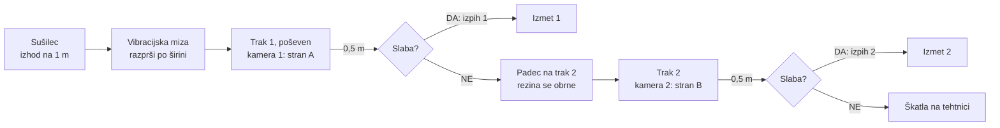
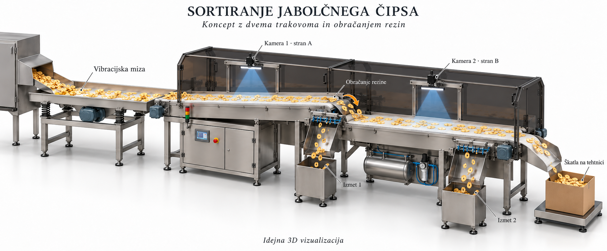
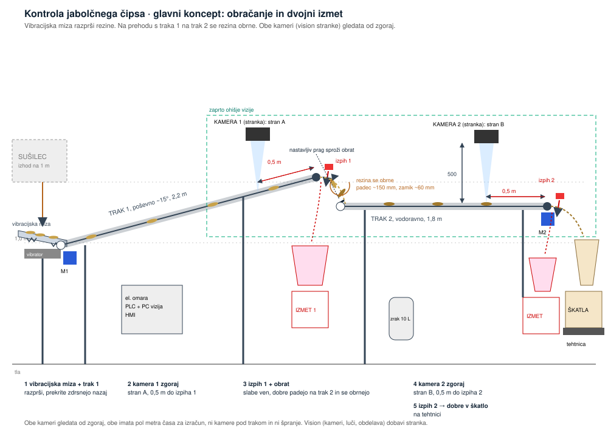

# Avtomatska kontrola jabolčnega čipsa

**Skupina A · LUI Scaleup Journey 2026 · odgovor na povpraševanje LUI-RFQ-02**

Predstavitev: 8 minut + 4 minute vprašanj. Podrobnosti so v [`kalkulacija_bom.md`](kalkulacija_bom.md).

---

## 1. Kaj smo razumeli (0:30)

| Zahteva | Vrednost |
|---|---|
| Vhod | rezine pridejo iz sušilca v razsutem toku, na višini 1 m |
| Dovod | okoli 5 m/min, pobrati moramo vse, kar pride |
| Prostor | naš trak največ 4 m, nadomesti obstoječi modri trak |
| Pregled | **obe strani** rezine, napake so črne pike (plesen) |
| Pogoj | rezine se ne smejo prekrivati, trak ne sme imeti špranje |
| Izhod | dobre v škatlo na tehtnici, slabe v ločen zabojnik |
| Vision | **ima že stranka**: kameri (fokus 500 mm), osvetlitev, obdelava slike in programiranje |
| Higiena | stik z živili, nežno, čim manj lomljenja |

## 2. Blokovna shema (1:00)

## 3. Naša rešitev (2:00)

**Obe kameri gledata od zgoraj. Rezino obrnemo, ne kamere.**

1. **Vibracijska miza** pod sušilcem prevzame kup rezin in jih razprši po širini.
2. **Trak 1**, poševen ~15°, 2,2 m: teče 3 do 4-krat hitreje od dovoda, rezine se razmaknejo, prekrite zdrsnejo nazaj.
3. **Kamera 1** pregleda **stran A**. Do glave traku je **0,5 m**, to je 1,5 s za odločitev.
4. **Izmet 1** na glavi traku 1: slabe rezine dobijo sunek zraka v zabojnik.
5. Dobre rezine **padejo ~150 mm na trak 2** čez nastavljiv prag in se **obrnejo**.
6. **Kamera 2** pregleda **stran B**, spet 0,5 m pred **izmetom 2**.
7. Dobre rezine gredo po žlebu v **škatlo na tehtnici**, ki javi, ko je polna.

### 3D koncept (Luka)

### Skica

## 4. Simulacija (1:00)

**Odpri simulacijo:** https://claude.ai/artifact/WuYUaRhEWF8TTdGYreND1W (datoteka v repozitoriju: [`simulacija.html`](simulacija.html), deluje tudi lokalno v brskalniku).

Kaj pokazati v eni minuti:
- **stranski pogled:** vibracijska miza razprši kup, trak 1 rezine razmakne, kamera 1 označi slabe (rdeč obroč), izpih 1 jih vrže v izmet, ostale padejo na trak 2 in se obrnejo, izpih 2, dobre v škatlo na tehtnici;
- **pogled od zgoraj:** vidiš razmike in pike na vidni strani; po padcu se pri obrnjenih rezinah pokaže druga stran;
- **drsnik »Višina padca«:** pri 50 mm se obrne ~50 % rezin in v škatlo gre več slabih, pri 150 mm ~88 %;
- **16 ali 32 ventilov:** z 32 je manj dobrih rezin izpihanih po nesreči;
- **dovod:** povečaj na 1.000 rezin/min, da pokažeš, da trak še vedno razmakne rezine.

Model je poenostavljen: verjetnost obrata je ocena (1 − e^(−h/70 mm)), pravo vrednost da preizkus s pravim čipsom.

| Izračun | |
|---|---|
| Hitrost dovoda | ~5 m/min |
| Hitrost trakov | 15 do 20 m/min (3 do 4-krat hitreje → razmak med rezinami) |
| Čas od kamere do izpiha | 0,5 m / 20 m/min = **1,5 s** (na obeh postajah) |
| Padec za obrat | ~150 mm, nastavljiv |
| Ventili | 16 na letev, vsak ~30 mm širine, odziv 1 do 3 ms |

## 5. Izbira tehnologij (1:00)

| Sklop | Izbira | Zakaj |
|---|---|---|
| Razporejanje | vibracijska miza + poševni trak, hitrejši od dovoda | miza razprši po širini, prekrite rezine zdrsnejo nazaj |
| Pregled obeh strani | obračanje rezine pri padcu s traka 1 na trak 2 | obe kameri zgoraj, obe imata dovolj časa, ni špranje |
| Vision | sistem stranke (kameri, luči, obdelava) | ga že ima in pozna; mi ga vgradimo in povežemo z izpihoma |
| Izmet | zračni izpih, 2 letvi po 16 ventilov | rezine tehtajo 1 do 3 g, ničesar se ne dotakne |
| Zrak | rezervoar 10 L, filter brez olja, tlačno stikalo | živilski zrak, zanesljivo (lekcija s škatlicami) |
| Krmiljenje | PLC Siemens S7-1200 + zaslon, enkoder na vsakem traku | točen položaj rezine do izpiha |
| Polnjenje | škatla na tehtnici | polni se po masi |

**Alternative, ki smo jih pretehtali:**
- **en trak s kamero spodaj v letu** (brez obračanja): okoli 6.000 € ceneje, a spodaj je za odločitev zelo malo časa in drobtine padajo na kamero;
- **mehanska loputa** za izmet: cenejša, a pri gostem toku vrže ven tudi dobre;
- **delta robot z vakuumom**: nežen, a drag in ne dohaja gostega toka.

## 6. Higiena, varnost, tveganja (0:45)

- **HACCP: neposreden stik z živilom.** Kontaktne površine inox AISI 304 in živilski PU, brez mrtvih kotov, trakova se snameta brez orodja za pranje, zrak brez olja, maziva H1, nad hrano ni stekla.
- **Varnost pri delu:** zaščite pogonov in vibracijske mize, ohišje vizije z varnostnimi stikali (ob odprtju se ustavita trakova in izpiha), gobi.
- **Tveganja:** ne obrne se vsaka rezina (nastavljiv prag in višina padca, preizkus s pravim čipsom, simulacija), lomljenje pri padcu (samo ~150 mm), lepljive rezine (vibracijska miza, nastavljiva hitrost), izpad zraka (rezervoar, ob alarmu stop).

## 7. Cena in povračilo (1:00)

| Sklop | Znesek |
|---|---|
| Planiranje (konstrukcija, ocena tveganja, CE) | 2.200 € |
| Mehanika (vibracijska miza, 2 traka, prag, žlebovi, pokrova; izdelava v Srbiji) | 8.200 € |
| Elektro (2 pogona, 2 letvi izpiha, zrak, tehtnica, senzorji, PLC program) | 7.100 € |
| Priklop vision sistema stranke na izpiha | 880 € |
| Elektro omara | 2.550 € |
| Preizkus pri nas, montaža in zagon | 1.760 € |
| Logistika | 800 € |
| **Lastna cena** | **23.490 €** |
| Rezerva 10 % | 2.350 € |
| Dodatek 30 % | 7.750 € |
| **Prodajna cena** | **≈ 33.600 € brez DDV** (vision dobavi stranka) |

**Za stranko:** stroj nadomesti ročni pregled. En človek na izmeno stane okoli 55.000 €/leto.

| | 1 človek | 2 človeka |
|---|---|---|
| **Povračilo** | **~0,9 leta** | **~0,4 leta** |

## 8. Faze, merila in kaj rabimo od vas (0:30)

**Faze:** test s pravim čipsom (obračanje, naklon, izpih) 2 tedna → konstrukcija 3 tedne → izdelava 5 tednov → preizkus pri nas z vašim vision sistemom → montaža pod sušilec in zagon → spremljanje prvi mesec.

**Merila uspešnosti:** obrnjenih ≥ 90 % rezin · izločenih ≥ 95 % rezin, ki jih vision označi kot slabe · nič prekrivanja pred kamerama pri polnem dovodu · škatla napolnjena na ± 20 g.

**Kaj rabimo od naročnika:**
1. vzorce dobrih in slabih rezin (za preizkus obračanja in izpiha);
2. koliko kg/h pride iz sušilca;
3. velikost, debelina in lepljivost rezin;
4. podatke o vision sistemu: kakšen signal da za slabo rezino (položaj, čas), priklop;
5. kam z izločenimi rezinami.

---

## Pričakovana vprašanja

- **Zakaj obračate rezine?** Trak ne sme imeti špranje. Tako obe kameri gledata od zgoraj, obe imata pol metra časa in nobena ni pod trakom, kjer padajo drobtine.
- **Kaj, če se rezina ne obrne?** Prag in višino padca nastavimo na vašem čipsu; cilj je ≥ 90 %. Simulacija pokaže, pri kateri višini se obrne največ rezin.
- **Zakaj dva izmeta?** Po obračanju se položaj rezine spremeni, zato je varneje izločiti slabe takoj za vsako kamero.
- **Zakaj zrak in ne mehanika?** Rezine so lahke in krhke; zrak jih ne poškoduje in je dovolj hiter za gost tok.
- **Kaj, če zmanjka zraka?** Rezervoar 10 L in tlačno stikalo; ob padcu tlaka se trakova ustavita, da slabe ne gredo v škatlo.
